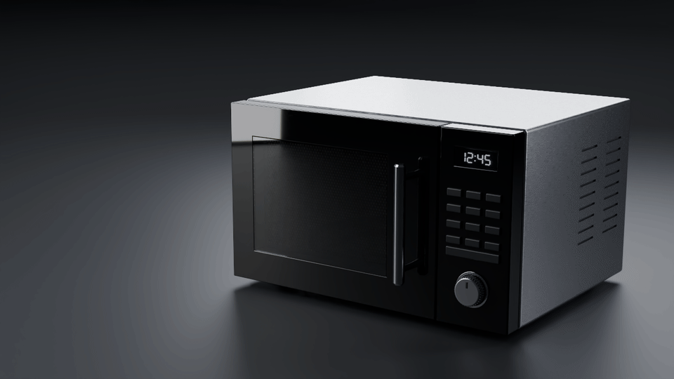
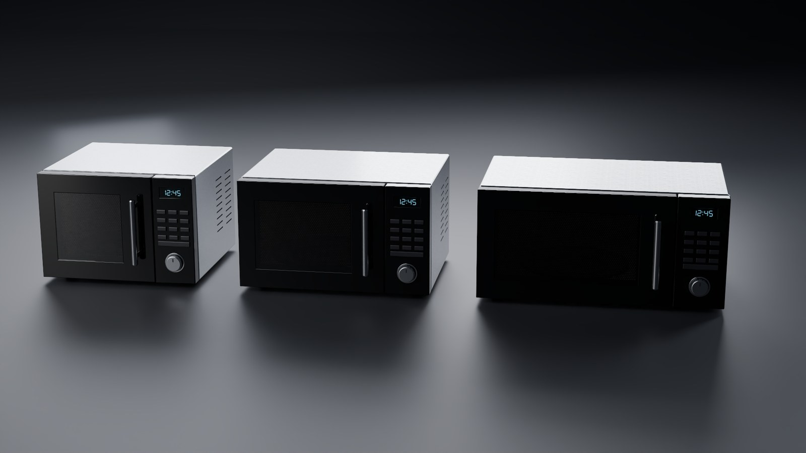

# Halation



*A procedural microwave authored in Halation's recipe language and rendered in Cycles. The door is a hinge joint, posed for this render; size dials keep the door, window and controls aligned.*

**An AI agent edits a procedural 3D document, and deterministic checks decide whether its work is right.** Halation is a desktop 3D authoring tool where a person and an agent work on the same typed recipe. The agent writes that recipe as text, so every result stays editable and every change is inspectable. Halation exports OpenUSD and renders in Cycles. Articulated assets for robotics simulation must pass certification in Isaac Sim, and a failed certification sends the agent back to repair its own work. The agent itself is measured by a 198-case eval suite.

Built by [Nat Bishop](https://github.com/nat-bishop). **Project showcase; source private.** A demo or code walkthrough is available on request.

## What it shows

- **The agent's output is a document, not pixels.** It reads and writes the same text recipe the app edits, with dials a person can change afterwards.
- **Certification is the gate.** Isaac Sim tests joint travel, return to rest, settling and response to applied effort. A failure goes back to the agent with its findings.
- **The agent is measured, not trusted.** 198 eval cases: 90 binary regression guards and 92 graded quality cases, with model-based judges checked against human grading.
- **A native 3D pipeline.** One typed graph covers modeling, materials, terrain and simulation; OpenUSD carries scenes; Cycles renders through Hydra; Rust kernels handle GPU compute.

## A failure caught and repaired

https://github.com/user-attachments/assets/9eaaa90e-d0ab-4e20-9c50-188f761ec4ca

*60 seconds, captioned. Gemini 3.8 Flash builds a procedural microwave from a commission. Certification in Isaac Sim finds the door stalling at 1.4° of 100°, blocked by a knob; the agent ties the door and knob positions to the width dial, and the second certification passes. Change a dial afterwards and Halation marks the recipe "changed since certified". The agent's turns replay a run recorded during an October 2026 eval; the build, renders and certification ran live in the app, with model requests switched off.*

## From request to revision

1. **Describe the result.** Give the agent a brief and references.
2. **Inspect its work.** Review generated geometry and renders, answer questions and steer the next revision.
3. **Keep the recipe.** Edit the graph or its text, change parameters, and build variations from the same procedural definition.


*The board in the September 2026 VFX showcase. The application is under active development.*

| Choose a direction | Review a render |
|---|---|
|  |  |

*Excerpts from a recorded VFX workflow in the September 2026 interface.*

## Articulated assets for robotics

Halation's SimReady workflow builds articulated OpenUSD assets and certifies them with a deterministic test battery: scene structure, joint travel and return to rest, settling and drop behavior, and response to applied effort. Isaac Sim runs the physical checks. Results are recorded for each tested asset version, alongside visual review.

One useful failure case is a gravity-loaded door with an underpowered motor: it can open through its full range but cannot lift itself closed. Testing the return to rest catches a defect that an opening-only sweep would miss.

## How I evaluate the agent

- **Regression checks and experiments have different jobs.** 90 binary guard cases catch broken behavior; 92 graded quality cases assess whether an agent change improves the result.
- **Judge the artifact.** A completed agent turn is not enough. Evaluation checks the produced geometry, appearance and requested behavior.
- **Check the judge.** Model-based visual scores are compared with human grading before they are used as evidence. Matched inputs and repeated baselines separate a real improvement from run-to-run variation.

## Example outputs



*One recipe, three values of its width dial. The door, window, keypad and dial move with it.*


| A server rack | An interior door | Eroded terrain |
|---|---|---|
|  |  |  |


*Authored procedural assets, rendered in Cycles.*

## Architecture

```text
Electron desktop app
  └─ Next.js / React interface
       graph editor · 3D viewport · board and review
          │ REST + WebSocket
     FastAPI backend
       typed document / DSL · director and job agents · cook / bake
       OpenUSD persistence · asset certification · MCP tools
          ├─ Rust core       shared semantics in Python and WebAssembly
          ├─ GPU kernels    terrain erosion and fluid simulation
          └─ Render worker  Cycles through OpenUSD Hydra
```

The same procedural definitions serve human edits and agent work. Native compute and rendering sit behind that document model.

The fluid engine has its own case study: **[Halation Fluid](https://github.com/nat-bishop/halation-fluid)**, covering FLIP/APIC liquids, smoke and fire, numerical validation and the Houdini integration.

**Stack:** Python · FastAPI · Pydantic AI · Rust · wgpu / WGSL · OpenUSD · OpenVDB · Cycles · Isaac Sim · TypeScript · Next.js · React Flow · react-three-fiber · Electron

## Status and contact

Active development. The application runs locally; this repository contains the case study and media. Source and installable packages are not publicly distributed.

For a demo or technical walkthrough, contact me through [LinkedIn](https://www.linkedin.com/in/nat-bishop/). See [my other work](https://github.com/nat-bishop).

© 2026 Nat Bishop. All rights reserved. Published for portfolio and evaluation purposes.
