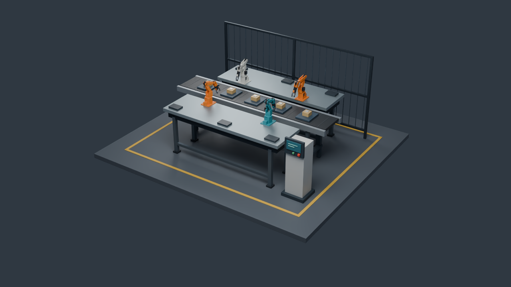
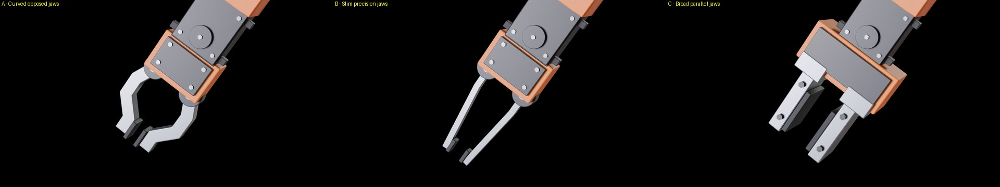
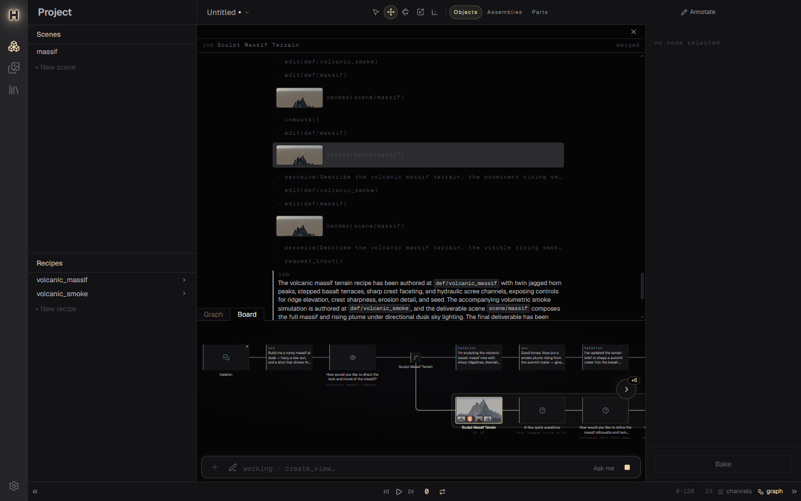
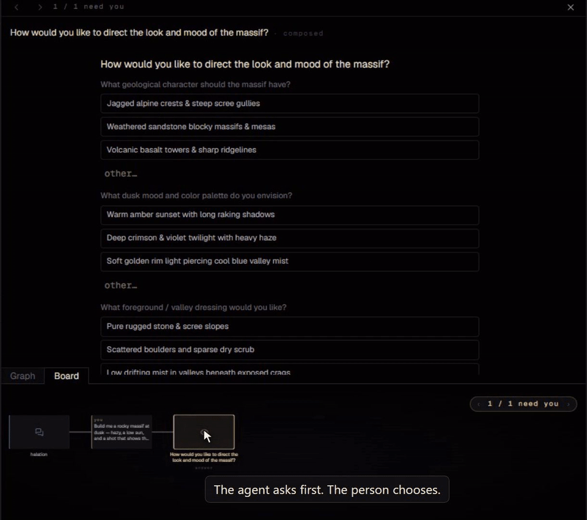
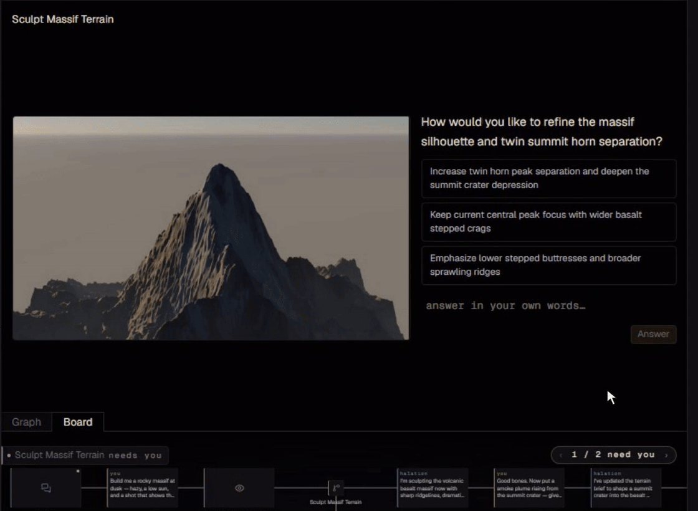
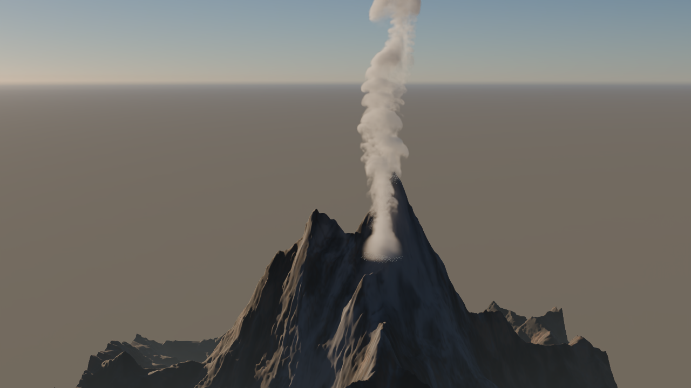
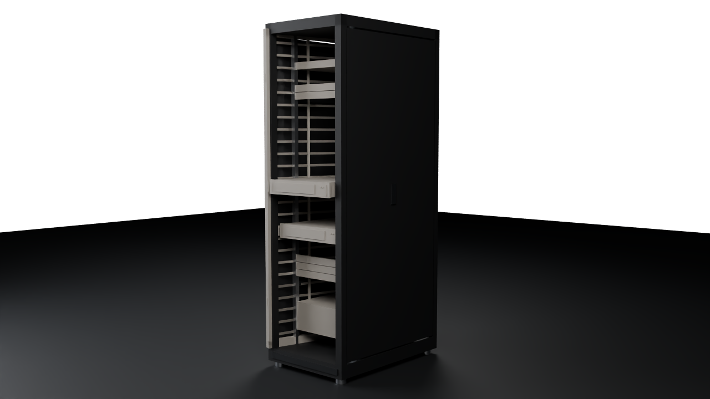
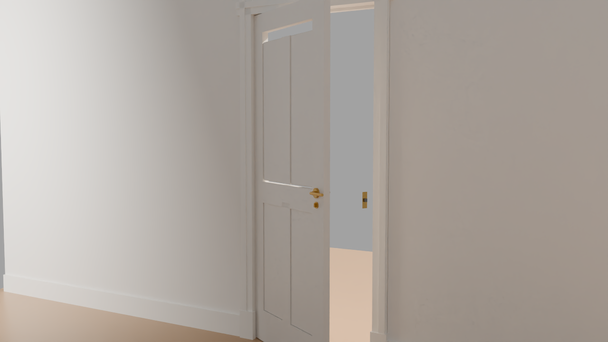
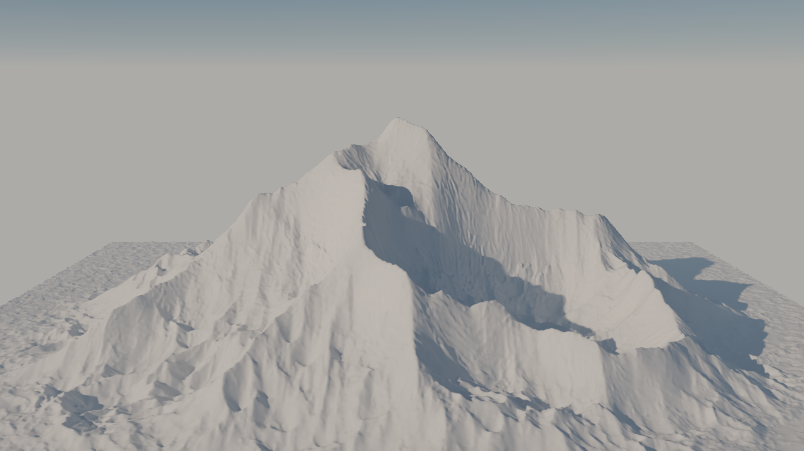

# Halation

**Editable procedural 3D, from a brief to a reusable asset.**

Halation is a desktop 3D authoring tool where a person and an AI agent work on the same procedural document. Describe an asset or scene, inspect the result, and refine the recipe. The output includes an editable typed node graph as well as the baked geometry, materials, terrain or volumes.

Built by [Nat Bishop](https://github.com/nat-bishop). **Project showcase; source private.** A demo or code walkthrough is available on request.



*An authored procedural assembly, rendered in Halation.*



*Three authored gripper variants share the same arm geometry. These demonstration assets illustrate procedural construction and variation; the images do not establish autonomous generation or physics validation.*

## What I built

- **An agent that edits the document itself.** The agent reads and writes the same text DSL used by the application. Its work remains inspectable, editable and reproducible as a procedural recipe.
- **A workflow for steering the result.** A director delegates jobs into isolated document forks. The board presents questions, renders and review checkpoints so the person can choose a direction and request changes.
- **A native 3D pipeline.** A typed graph connects modeling, materials, terrain and simulation. OpenUSD carries scenes and assets; Cycles renders through Hydra; Rust kernels handle shared semantics and GPU compute.
- **Validation for articulated assets.** The robotics workflow pairs procedural assets with structural and motion checks, so a convincing render is only one part of the evidence.

## From request to revision

1. **Describe the result.** Give the agent a brief and references.
2. **Inspect its work.** Review generated geometry and renders, answer questions and steer the next revision.
3. **Keep the recipe.** Edit the graph or its DSL, change parameters, and build further variations from the same procedural definition.



*The board in the September 2026 VFX showcase. The application is under active development.*

### Recorded VFX workflow

[Watch the 30-second VFX teaser](docs/media/halation-teaser.mp4)

The clips below show questions and render review in the September 2026 interface. They are excerpts from an earlier recorded workflow. The teaser's plume reveal compares rendered stills.

| Choose a direction | Review a render |
|---|---|
|  |  |

## Example outputs



*A rendered scene from the September 2026 VFX showcase.*

| A server rack | An interior door | Eroded terrain |
|---|---|---|
|  |  |  |

## Articulated assets for robotics

Halation's SimReady workflow builds articulated OpenUSD assets and evaluates them with a deterministic test battery. Checks include scene structure, joint travel and return to rest, settling and drop behavior, and response to applied effort. Isaac Sim provides runtime testing for the supported checks.

One useful failure case is a gravity-loaded door with an underpowered motor: it can open through its full range but cannot lift itself closed. Testing the return to rest catches a defect that an opening-only sweep would miss.

Results are recorded for each tested asset and protocol, alongside visual review.

## How I evaluate the agent

- **Regression checks and experiments have different jobs.** Deterministic cases catch broken behavior; comparative evaluations assess whether an agent change improves the result.
- **Judge the artifact.** A completed agent turn is not enough. Evaluation checks the produced geometry, appearance and requested behavior.
- **Check the judge.** Model-based visual scores are compared with human grading before they are used as evidence. Matched inputs and repeated baselines help separate a useful improvement from run-to-run variation.

## Architecture

```text
Electron desktop app
  └─ Next.js / React interface
       graph editor · 3D viewport · board and review
          │ REST + WebSocket
     FastAPI backend
       typed document / DSL · director and job agents · cook / bake
       OpenUSD persistence · asset validation · MCP tools
          ├─ Rust core       shared semantics in Python and WebAssembly
          ├─ GPU kernels    terrain erosion and fluid simulation
          └─ Render worker  Cycles through OpenUSD Hydra
```

The same procedural definitions serve human edits and agent work. Native compute and rendering sit behind that document model.

The fluid engine has its own case study: **[Halation Fluid](https://github.com/nat-bishop/halation-fluid)**, covering FLIP/APIC liquids, smoke and fire, numerical validation and the Houdini integration.

**Stack:** Python · FastAPI · Pydantic AI · Rust · wgpu / WGSL · OpenUSD · OpenVDB · Cycles · Isaac Sim · TypeScript · Next.js · React Flow · react-three-fiber · Electron

## Status and contact

Active development. The application runs locally; this repository contains the case study and media. Source and installable packages are not publicly distributed.

For a demo or technical walkthrough, contact me through [LinkedIn](https://www.linkedin.com/in/nat-bishop/). See [my other work](https://github.com/nat-bishop).

© 2026 Nat Bishop. All rights reserved. Published for portfolio and evaluation purposes.
